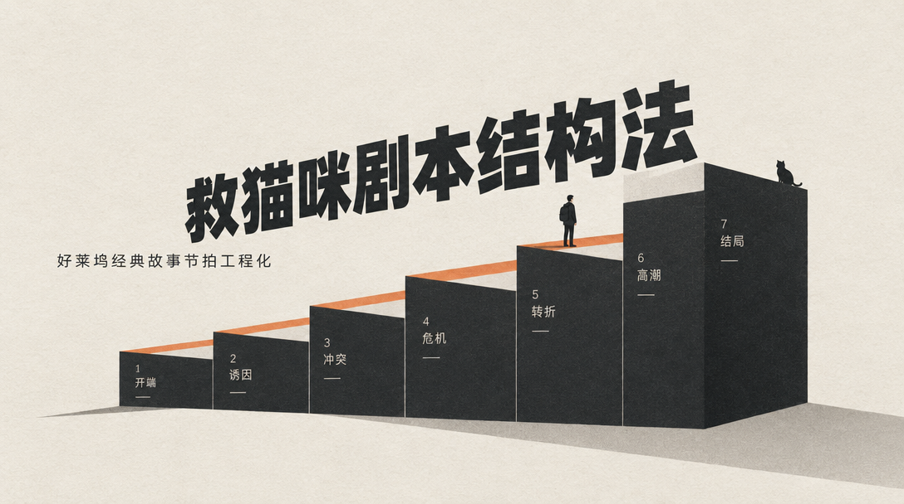
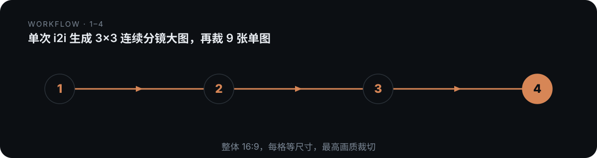

# domn-film-storyboard-3x3



> 单次 i2i 生成 3×3 连续分镜大图，再裁 9 张单图。

## 是什么

单次 i2i 生成 3×3 连续分镜大图，再裁 9 张单图。本仓库是一个 Agent 技能（SKILL.md 为唯一权威定义），把上面的方法论沉淀为可被对话触发的可执行流程。

## 怎么做（工作流）

<p align="center">
  
</p>

1. **读参考图**
2. **写剧情提示**
3. **生成九格**
4. **裁单图**

## 怎么用

将本仓库放入支持 `SKILL.md` 的 Agent 技能目录：

- **WorkBuddy**：`~/.workbuddy/skills/domn-film-storyboard-3x3/`
- **Codex / 其他**：对应 skills 目录

然后在对话中触发，例如：

```
用 domn-film-storyboard-3x3 帮我处理一段需求。
```

## 依赖

纯提示词方法论 + 裁图脚本；出图依赖图像生成模型（i2i）.

## 仓库结构

```
domn-film-storyboard-3x3/
├── SKILL.md                 # 技能定义（唯一权威）
├── references/              # 方法论弹药库
├── assets/                  # 模板 / 占位素材
└── assets/readme/           # 本 README 的视觉资产（hero.webp / workflow.svg）
```

## 许可

本仓库内容以 `SKILL.md` 为唯一权威定义。如附带 `LICENSE` 文件，以其为准。

---

*README 由 `beautify-github-readme` 生成 · 封面图来自作者作品集，强调色由封面图采样派生。*
